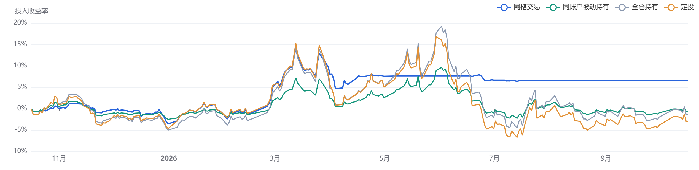
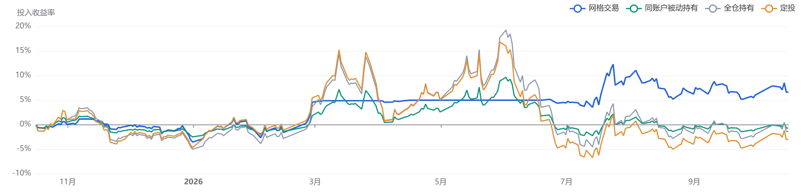
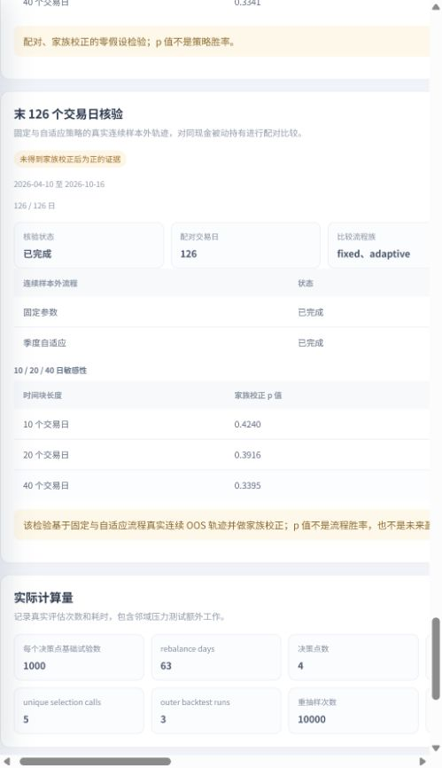

# 159611 科学参数选择系统验收

验收日期：2026-10-17（北京时间）。本记录验证科学参数研究 v2 的实现、时间边界和数值一致性，使用真实历史行情。

## 数据与预先约定

- 标的：**159611.SZ，电力 ETF 广发**；不可变快照：`4aa1d7dbe8a0d0d2ae3f9b19`，非演示数据。
- 样本外评估：**2025-10-16～2026-10-16，共 243 个交易日**；准备区间含前置训练与估值数据，共 748 个交易日，分钟保留率 **100%**。
- 初始持股 **10000 份**，锁定现金 **10555.30 元**，初始资产 **21095.30 元**；估值参考为 2025-10-15 收盘价 1.054 元。所有候选与固定、自适应、同账户被动基准使用同一初始账户。
- 每次择参最多向前读取 504 个交易日：前 252 日生成候选，后 252 日分四个 63 日验证窗。每个决策 1000 次基础试验，种子 42；默认回撤约束 20%、至少 10 笔成交并含买卖两向。
- 评分同时考虑净收益、精确分钟路径回撤、跨窗波动、参数正负一步邻域，以及加倍佣金、最低佣金和滑点。完整定义见 [科学研究协议](scientific-selection.md)。
- 每 63 个交易日重选，历史决策仅使用生效前一交易日及以前的数据。两条历史流程的最终表现不参与当期参数选择。

参数范围继承个人研究设置：等比步长 0.2%～3.0%、步长 0.2 个百分点；每次买入／卖出 500～1500 份、步长 100 份；最低持股 0～5000 份、步长 1000 份；最高持股固定 20000 份。初始持股不参与搜索。

## 样本外结果

费用已计入回测收益。最大回撤来自实际分钟执行路径，图表只抽取每日权益，未用日收盘回撤替代分钟风险。

| 流程 | 累计收益 | 最大回撤 | 成交笔数 | 费用（元） |
| --- | ---: | ---: | ---: | ---: |
| 评估开始前锁定固定参数 | 6.49% | 8.98% | 664 | 230.46 |
| 每 63 个交易日自适应 | 6.60% | 7.58% | 359 | 133.46 |
| 同持股、同现金被动持有 | -0.71% | 11.48% | 0 | 0.00 |

固定参数在 2025-10-15 收盘后锁定：等比间距 2.0%，最低持股 0、最高持股 20000，每次买入 600、卖出 700 份。



自适应账户沿用原有现金、持股、可卖股数、参考价与未到账权益；换参时撤销旧规则待成交意图，依据此前已知收盘信息重建，下一真实开盘执行。没有在换参日重新开户、注入本金或虚构清仓。

| 决策收盘 | 生效日 | 等比间距 | 最低持股 | 最高持股 | 每次买入 | 每次卖出 |
| --- | --- | ---: | ---: | ---: | ---: | ---: |
| 2025-10-15 | 2025-10-16 | 2.0% | 0 | 20000 | 600 | 700 |
| 2026-01-14 | 2026-01-15 | 1.8% | 0 | 20000 | 900 | 1100 |
| 2026-04-22 | 2026-04-23 | 2.2% | 4000 | 20000 | 800 | 600 |
| 2026-07-24 | 2026-07-27 | 2.6% | 1000 | 20000 | 700 | 1100 |



图中的全仓和定投为原有独立账户辅助比较；主要统计基准始终是“同账户被动持有”。

## 当前建议与证据状态

截至 **2026-10-16** 的下一期建议为等比间距 **1.2%**、最低持股 **1000**、最高持股 **20000**、每次买入 **1000**、卖出 **1200** 份，固定初始持股仍为 10000 份。其稳健选择分约 **-0.010923**：满足预设交易与回撤约束，但只是本次候选中相对最佳，不构成正向收益证据。

当前建议使用的 504 日窗口为 2024-09-11～2026-10-16；完整冻结候选族 **3680** 组，包含中心与邻域，252 个验证交易日。候选族内部检验复用原成本日收益矩阵，明确记录 `sample_role=internal_validation_used_for_selection`、`independent_oos=false`。

末段流程检验取两条历史流程真实连续路径的最后 **126 日：2026-04-10～2026-10-16**。它不重新初始化末段账户，也不使用截至评估结束才选出的当前建议。两类检验各做 10000 次配对 stationary bootstrap，并同时校正完整候选族或预先声明的固定／自适应流程族。

| 平均时间块长度 | 当前候选族内部检验 p 值 | 末 126 日流程族检验 p 值 |
| --- | ---: | ---: |
| 10 日 | 0.5467 | 0.4240 |
| 20 日，主检验 | 0.4613 | 0.3916 |
| 40 日 | 0.3341 | 0.3395 |

主末段检验中，参照流程自适应的 95% 同时置信下界为 **-0.00083967／日对数超额收益**，跨过零。因此本次结论是：**样本外收益为正，但没有得到家族校正后优于被动基准的统计证据**。p 值不是获利概率，不能把当前参数的样本内回看称作历史样本外成绩。



## 正确性与计算量

完整验收脚本 **23／23 检查通过**，覆盖：

- 真实分钟数据、覆盖率、固定资金、决策严格早于执行、最新建议截止日。
- 修改历史断点之后全部 OHLC／前收盘并更换数据版本，断点处历史参数、评分、过去成交与净值均不变。
- 同一真实分钟路径上，批量与逐候选执行的日收益差为 **0**，分钟回撤、成交费用及摘要完全相同。
- 重采样计数矩阵与共享索引参考循环的最大差为 **3.91×10⁻¹⁸**。
- 最新参数历史重跑明确标为样本内；API 同时保留两条历史曲线，默认响应不携带全部档案矩阵。
- 当前检验覆盖全部 3680 个候选，不能用两条历史流程冒充候选族多重校正；各块长均完成请求的 10000 次重采样。
- 重用首个固定决策时不重复统计工作量；仅在全部科学研究阶段完成后报告 100%。

本轮实际执行 **5 次独立择参**，历史自适应共 **4 个决策点**。独立窗口候选共 **16402**，其中额外邻域 **13387**；生成阶段独立回放 **3010** 次，原／双成本验证 **32804** 次，合计 **35814** 次候选回放。完整候选和试验没有按页面展示上限截断。

本机完整研究约 **73.00 秒**；额外因果与一致性验收合计约 **91.62 秒**。128 个候选×126 个真实交易日、两端预热、三次同输入计时的中位数：批量 **0.02975 秒**，逐候选 **0.18439 秒**，约 **6.20 倍**。计数矩阵只优化重采样统计归约；该独立算子测量不能当成整项研究加速比。时长受本机缓存、并发及硬件影响。

完整结果约 63.92 MB；页面默认 API 响应约 2.89 MB。完整 JSON 仍保留所有档案供下载。后端完整回归 **183 项通过**；前端 **18 项通过**并完成 TypeScript／Vite 生产构建。浏览器走查已核对真实结果载入、双曲线、统计状态、历史准备记录折叠、重复研究提示和两条曲线 PNG 导出。

本机 `127.0.0.1:8000` 服务已载入最终代码，已在无运行中或排队任务时重新启动。健康检查、v2 接口模型、真实结果、默认响应裁剪、去重后的邻域计数及双曲线六项核对通过，浏览器正式地址未出现新增控制台错误；临时验收服务已停止。HTTP JSON 采用紧凑序列化，实测默认响应约 2.66 MB，与上述档案序列化大小口径不同。

## 复现与审计

```powershell
.\.venv\Scripts\python.exe scripts/validate_scientific.py
```

脚本只使用已有真实快照，向应用保存可查看的研究任务，不改写行情。也可用 `--result-id` 复用已完成结果执行额外核验。报告采用临时文件加原子替换，避免覆盖旧报告途中截断内容。

- 本轮任务：`9c0b902e3eb947c781cfc6b977ae5a70`。
- 结果：`1d88cb912cb84d5f84e52719b6b381a5`，可在“回测与研究”的研究任务记录中查看。
- [机器可读验收记录](159611-scientific-acceptance.json) 保存配置、全部检查、统计、资金、性能及完整结果绝对路径。
- [科学研究协议及文献依据](scientific-selection.md) 记录时序、评分、统计假设及不足样本处理。

本地审计如实记录前两次同区间验证研究，重叠计数 **2**；最后报告没有删除或隐藏这些尝试。`human_untouched_verified=false`，程序不能证明研究者此前从未看过这段行情。三次完整运行使用相同约定，核心参数和收益一致；后续补充统计诊断、页面修复及工作量去重未按收益调优。
