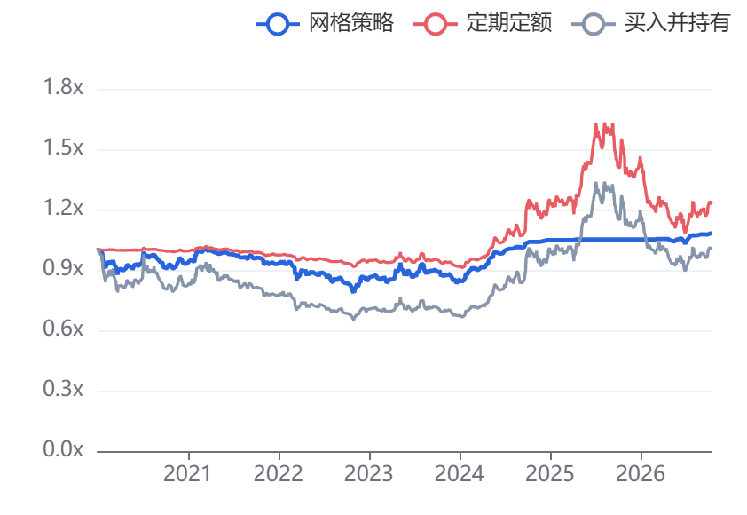

# 本机验收记录

## 同花顺分钟回退接入（2026-10-21）

近期 1 分钟来源增加同花顺回退：默认新浪失败后先按既有规则尝试默认／可选来源链，仍失败则请求同花顺 `d.10jqka.com.cn` 滚动窗口。回退不改变主来源配置，实际使用来源写入 `recent_minute_route` 和来源健康状态。

- 真实 `517520.SH`：滚动响应约 1.0 万根、42 个交易日（含当日未完成会话）；过滤未完成当日后返回 9,881 根、41 个完整交易日，每日 241 根（09:30～15:00）。开盘、最高、最低、收盘与本地日线逐日一致，成交量与日线最大相对差约 `2.1e-8`，按日缩放后的成交额与官方日线一致。
- 真实 `159611.SZ`：原始滚动响应 11,327 根、47 个交易日；过滤未完成当日后返回 11,086 根、46 个完整交易日，每日 241 根。OHLC 与本地日线逐日一致。该接口返回的成交量以股为单位；本地部分早期日线记录的量纲不同，实际增量窗口仍由既有日线量纲核验处理。
- 同花顺不提供逐分钟成交额。实现使用 `volume × OHLC4` 估算，并在有本地日线时按日缩放至官方成交总额；这是估算字段，不应当作来源原生逐分钟成交额用于因子研究。
- 回退不只在异常时触发：模拟新浪对 `517520.SH` 的 2026-10-08 仅返回 10:21 之后的数据时，覆盖检查识别出“缺 50 根、最长连续 50 根”，自动改取同花顺；结果为 241 根原始记录（含 09:30 竞价）、成交量 157,102,330，与当日日线一致。
- 接口可能间歇返回 HTTP 502；来源分类将 5xx 视为瞬时可重试网络错误，重试后仍失败才继续下一来源。
- 新增解析、跨年时间标签、回退链、覆盖检查和 5xx 分类单元测试；最终后端 **373 passed, 52 skipped**，前端 **61 项测试通过**，TypeScript 检查与 Vite 生产构建通过。

## 当前增量校验规则（2026-10-19）

正式合规标签分别针对日线和 1 分钟。每个交易日的结果保存在 `parquet_day_validation`，包含行情摘要、规则版本、依赖摘要、覆盖报告和检查时间。默认校验只处理未检查、失败或已失效的交易日；当前版本已连续合规时不读取 K 线。历史修订只删除对应交易日的结论，日线修订同时撤销相关分钟日的依赖结论。旧数据集的 `ready` 状态不直接继承为合规标签。

全量 Parquet 替换会比较逐日摘要：内容相同的日期保留原校验结果，修改或删除的日期撤销结论后重新检查。累计达到 8 个增量分片的单个标的周期会在后台整理，整理前后版本均可读取。

验收日期：2026-10-14～2026-10-17，北京时间。本记录对应当前工作目录中的实现与本机数据，网络来源的后续可用性、数据修订及其他机器的运行时间不在本次测量中。

## 数据源治理与 1 分钟历史调整（2026-10-18）

本次以 `600000.SH`、`159611.SZ` 做有超时限制的只读探测，探测结果用于确定默认来源和失败分类；以下记录的是本机当次可用性，不构成长期服务承诺。

- BaoStock 登录、真实交易日历、股票及 ETF 日线、5/15/30/60 分钟均正常返回。周线、月线在移除日线专属字段 `preclose`、`tradestatus`、`isST` 后正常返回；代码已改用 `date,open,high,low,close,volume,amount,pctChg`。
- 东方财富 ETF 日线经当前代理和临时进程内禁用代理均连接失败，默认来源已改为 BaoStock。ETF 分红接口返回 7,500 行、拆分接口返回 96 行，因此日线和基金资料按独立能力记录状态。
- 通达信四个现有节点均能建立 TCP 连接，但行情响应体只有 2 字节且声明 800 条记录，`pytdx` 解析抛出 `unpack requires a buffer of 4 bytes`；库默认吞掉异常，旧实现因此误报为“没有返回分钟数据”。默认近期分钟改为新浪，通达信仅作为手动检测通过后的可选来源。
- 新浪近期 1 分钟对股票和 ETF 均返回 1,970 行，覆盖 2026-09-29 13:53 至 2026-10-16 15:00，无非正 OHLC；现有独立 BaoStock 5 分钟和日线校验通过，股票匹配分数约 0.982，ETF 约 0.995。
- Hugging Face 历史下载、固定 revision、全市场历史目录和下载量估算已从运行依赖移除。旧数据中的 `hf` 来源标签仍可读取；1 分钟更早历史只通过当前数据包登记或本地导入补齐。
- 新增来源健康缓存、24 小时冷却、单次回退、探测任务和页面状态。方案要求协议错误不重试、瞬时连接错误最多重试一次、包内已有证券更新不刷新全市场目录。
- 最终后端回归 **268 passed**；前端 **40 项测试通过**，TypeScript 检查与 Vite 生产构建通过；`sync-market.ps1`、`start.ps1`、`restart.ps1` 语法检查和 Python `compileall` 通过。最终真实探测中，新浪股票/ETF 各 1,970 行，BaoStock ETF 日线 19 行；通达信记录为 `protocol`，东方财富日线记录为 `network`，两者均未触发默认任务调用。

## 159611 本地分钟校验与同步状态（2026-10-17）

本次核对的是已经入库的手动导入与接口同步数据，未重新下载或修改原始行情。早期同步的摘要仅有 8 个分钟日，导入后未重建，并且来源失败提示被带入行情、回测和研究；新实现依据合并后的实际数据投影当前状态，历史来源记录单独保存。旧快照与完整结果文件不改写，派生校验缓存按规则版本失效。

- 真实 `159611.SZ` 快照包含 **1,154 个交易日、276,946 条分钟记录**：手动导入 2022-01-07～2026-09-30，1,147×240 条；新浪接口 2026-10-08～2026-10-16，7×238 条。
- 有效交易分钟缺口 **0**，日线降级 **0 日**，实际修复 **0 根**；14 个缺少原始行的 `14:58/14:59` 网格位置单列为收盘竞价估值占位。保留真实 `15:00` 收盘成交和所有已有竞价记录。
- [只读验收 30 项全部通过](159611-minute-data-acceptance.md)：快照与数据文件哈希不变，下载/同步调用为 0，固定／自适应 1 分钟账本的指标、净值、交易、拒单和分期收益均与保存结果一致。
- 后端 208 项全量回归通过，追加的日线 API 用例在 12 项定向回归中通过；前端 24 项测试、TypeScript 检查及 Vite 构建通过。真实浏览器核对行情当前状态、问题日筛选为空，以及已保存科学研究显示完整、来源区间和竞价占位正确。
- 主动选择日线时，分钟指标显示“本次未校验”，不再把所选日线模式误称为分钟降级；真实分钟缺口、未校准和公司行动风险仍保留。

## 科学参数研究 v2（2026-10-17）

按要求使用 **159611.SZ 真实分钟快照**，完成固定参数与季度自适应两条历史样本外流程、当前参数族内部验证及末 126 日流程检验。504 日滚动窗口、同账户资金、中心与邻域、双成本和多重检验细节见 [专门验收报告](159611-scientific-acceptance.md) 与 [研究协议](scientific-selection.md)。

- 完整后端 **183 项测试通过**；前端 **18 项测试通过**，生产构建成功。浏览器使用真实 159611 研究记录核对结果展示与 PNG 导出。
- 真实验收脚本 **23 项检查全部通过**：未来行情不影响过去参数、评分、成交及净值；批量与逐候选回放一致；当前建议回看带样本内标记；全部候选族检验与两条流程检验分开记录。
- 评估期为 2025-10-16～2026-10-16，共 243 个交易日，准备区间分钟保留率 100%。同一初始账户下，固定／自适应／被动收益为 **6.49%／6.60%／-0.71%**，最大回撤 **8.98%／7.58%／11.48%**。
- 末 126 日主检验 p 值约 **0.3916**、同时置信下界跨零，当前 3680 个候选内部检验 p 值约 **0.4613**；结果明确显示尚无家族校正后的正向证据。
- 研究约 73 秒；预热后 128 个候选×126 日的批量回放中位数约 0.02975 秒，逐候选约 0.18439 秒，日收益差为零。此为本机测量，未作为未来表现或其他机器速度的承诺。

## 独立账户曲线与合并工作台（2026-10-16）

本次将回测与参数研究合并为同一工作台，三策略曲线统一为资产总值除以各自累计投入；历史验收与历史结果保留原口径。

- 后端最终完整检查：`.venv/Scripts/python.exe -m pytest -q`，**102 passed**，耗时约 25.51 秒；仅有既有 Starlette/httpx 弃用提示。随后针对导出响应改用完整字节响应，复跑 `tests/test_api.py`，**2 passed**，覆盖 JSON、净值和成交 CSV。
- 前端 `npm run build` 通过 TypeScript 与 Vite 生产构建，`git diff --check` 无空白错误。
- 浏览器视口实测 **1920×1080**，页面位于顶部时，三线图、核心指标、两个运行按钮和当前任务状态在首屏；运行按钮下边缘约为 861px。配置区域独立滚动，定投初始仓位和佣金可以在同一参数区域查看。
- UI 使用隔离目录 `.local/independent-accounts-qa` 的明确标记演示行情与独立设置，未改写正式行情库或个人费用设置，也未启动真实数据下载、全市场同步或系统计划任务。
- UI 已走通费用修改后刷新恢复、编辑后立即离页返回、保存配置载入不覆盖个人费用记忆、两份配置批量回测、5 次历史参数搜索、候选载入、长搜索取消后保留候选、同页研究结果入口、正式回测至结果分析，以及净值 CSV 和三线图 PNG 下载。
- 导出检查逐行核对了一个分钟回测的 **187,920 行净值**（每种策略 62,640 行），三策略均满足 `normalized_equity = equity / total_invested`；成交 CSV 为网格 46 笔、定投 13 笔，全仓无虚构建仓成交。JSON 保存新的独立账户口径标记和锁定数据版本。
- 浏览器净值 CSV 的约 17 MB 下载在优化后约 2.7 秒完成；已消除内存内容按 CSV 行逐条发送造成的额外开销。

| 本次关键场景 | 验证内容 |
| --- | --- |
| 策略独立性 | 网格资金和参数变化不改变全仓与定投；定投设置不改变网格或全仓；网格零本金不清空其他账户。 |
| 初始持仓与收益 | 定投初始股数默认 0、全仓固定 1000 股／份；各自前收盘估值，期初股份获得适用股息与送转权益；投入、零投入、费用及分段初值正确。 |
| 内核一致性 | Numba 与解释执行、完整曲线、每日预览和优化摘要共用独立账户口径。 |
| 本地只读计算 | 空库和缺少前置行情时返回 `DATA_NOT_READY`，不调用来源；显式同步与导入任务负责准备数据，并覆盖周期隔离、指纹去重和恢复。 |
| 发布和并发 | 硬质量错误不替换活动快照；两个独立数据服务并发同一请求仅同步一次；等待准备锁可取消，同范围新预览接续准备。 |
| 费用兼容 | 默认 0.05% 与 0.1 元，局部保存、重启恢复、合法零值、非法输入保护，旧设置补默认值。 |

本机截图 `workbench-1080p.jpg`、`results-1080p.jpg`、下载文件与导出核对脚本保存在上述隔离目录；这些演示收益仅用于验收显示和计算流程。真实来源的联网可用性及覆盖边界沿用后文的已有记录，本次没有用演示数据冒充真实下载。

## 本次全市场、ETF 与股数配置改造（2026-10-15）

本节是新版实现的验收记录；后文保留改造前的历史测量，旧现金/比例结果仍可读取，不能将旧版资金和定投假设套到新版。

- 最终后端测试：`.venv/Scripts/python.exe -m pytest -q`，**78 passed**。仅有一条 Starlette TestClient / httpx 弃用提示。
- 前端 `npm run build` 通过 TypeScript 检查与 Vite 生产构建；`start.ps1`、`sync-market.ps1` 通过 PowerShell 语法解析，`git diff --check` 无格式错误。
- PC 页面检查使用 1366×768 和 1600×1000。1366×768 的净值标题位于首屏约 216px，参数区域独立滚动，曲线无需先滚过整张表单；按用户要求不将手机端列为交付验收目标。
- UI 验收在隔离目录 `.local/implementation-qa` 使用明确标记的股票 / ETF 演示行情完成：行情搜索、ETF 五分钟周期与均线、网格字段切换、费率连续小数输入、自动预览、正式回测到结果分析、定投独立收益及参数研究有效范围。测试没有改写正式行情库。
- 本次没有启动全市场下载，没有安装或修改 Windows 系统计划任务。全量下载与计划安装通过交付的 `sync-market.ps1` 由使用者之后运行。

| 新版场景 | 验证内容 |
| --- | --- |
| 全市场任务 | 126 个测试目标包含 ETF，超过搜索分页默认条数；全市场任务不改变自选；部分失败自动重试、仅失败恢复、全失败报告仍可查看。 |
| 检查点和迁移 | 日线 / 分钟状态及截止分别存储；模式与来源版本区分检查点；增量采用真实交易日历的已收盘日期；重复初始化 SQLite 不丢记录。 |
| 增量快照 | 重复发布相同行情无重复记录；只改受影响年份，复用另一年文件；旧快照继续返回旧值。 |
| 股票 / ETF 账户 | 现有持股无建仓交易；T+1 股票与 T+0 黄金 ETF 当日可卖数量不同；ETF 不收股票印花税和股票过户费；创业板 ETF 日期规则分界。 |
| 公司行动与导入 | 开始前已有持股享有首日除息权益，定投不凭空获得；ETF 导入不要求 ST，显式类型和分红核验可以保留、覆盖来源状态。 |
| 数量、费用与搜索 | 正数量以 100 为单位，费用允许小数；股数直接整数搜索；隐藏网格参数不进入新版验证或搜索。 |
| 日期与行情 | 周末查前一个有效收盘；缺少前置价格拒绝；填入的结束日期保持，实际计算截至本地有效日；均线读取前置数据；真实周期和未核验 / 缺口标识。 |
| 定投 | 每天 / 每周 / 每月固定数量；停牌期延后至周期内可成交日；整期无法成交记录跳过；无投入收益率为空，新增投入不形成收益；不计算固定本金年化或夏普。 |
| 一致性与预览 | Python 与 Numba 股数账本、成交和拒单一致；摘要及预览与完整回测一致；预览不保存任务或结果；正在计算时快速提交的新请求覆盖中间待算参数，旧结果不覆盖新版本。 |
| 兼容 | 旧配置按真实历史价格转成独立股数草稿，原记录不变；旧计算内核测试继续通过；新结果保存数据快照与口径。 |

### 本次少量联网检查

仅使用 `600000.SH` 与 `510300.SH`，没有发起全市场任务。

- 股票与 ETF 日线分别成功返回 2026-10-08 至 2026-10-14 的 5 行真实日线及 5 个真实交易日，资料核验标记为真。
- 股票近期分钟：通达信节点不可用，新浪返回 1732 行，范围为 2026-09-28 13:53 至 2026-10-14 15:00。日线总量可匹配 5 天，但该探测没有完成独立时间标签核验，报告保留未核验状态，不能据此宣称可靠分钟回测覆盖。
- ETF 近期分钟：东财 trends2 1 分钟接口对历史交易日返回开盘价 0.000（实测 2026-10-12 至 15 的 ETF 数据），已从备源移除。新浪 1 分钟接口对 ETF 返回完整 OHLC：`159611.SZ` 1970 行、2026-09-29 13:53 至 2026-10-16 15:00，非正价格 0 条；经独立 BaoStock 5 分钟参考校准为结束标签、1 倍量纲，7 个交易日通过日线总量与价格核验，参考匹配分数约 0.995。
- 固定 ETF 历史库目录覆盖 7 只；新浪 1 分钟仅提供近期约 8 个交易日是来源公开边界，不代表本项目可补齐所有 ETF 早期分钟缺口。来源文档与规则链接见 README 和 rules.md。

本地探测 JSON 和 UI 截图在 `.local/` 下，属于本机验收证据，不作为仓库内真实行情样本分发。

## 改造前的历史验收记录

## 运行环境与检查

- Windows 11，Intel Core Ultra 5 125H，18 个逻辑处理器，约 31.46 GiB 物理内存。
- Python 3.12、NumPy 2.3.5、Numba 0.68.0；依赖由 `uv.lock` 锁定。前端通过 TypeScript 检查及 Vite 生产构建。
- 自动化测试覆盖数据、账户、交易规则、参数搜索和 API 工作流。最终 `uv run pytest -q` 为 **54 passed**，另有一条 Starlette/httpx 弃用提示。具体性能测量与一致性结果见 [performance.json](performance.json)。
- 内置浏览器实际验证了自选数据查看、质量日历、配置日期与资金修改、命名保存、推荐配置载入、独立账户批量回测、历史搜索、结果图表与成交 CSV / PNG 下载。

| 验收项目 | 已验证的行为 |
| --- | --- |
| 数据重复导入与版本 | 重叠行情按时间去重；相同分区重复发布不产生重复记录；按保存版本加载历史数据，后续活动快照不会改变旧结果及其 K 线。 |
| 少量缺口与整日降级 | 连续不超过 3 根、全日不超过 5 根的合格缺口用此前真实价格补齐；补齐条不触发交易；严重缺口仅使用真实日线。 |
| 日历、停牌及缺失日线 | 依据真实交易日历和历史状态区分停牌；未知原因缺少日线时阻止完整回测，不用普通工作日补造交易日。 |
| 撮合与账户 | 收盘信号在下一真实开盘执行；涵盖午休、隔夜、跨多格、封板、最低费用、资金不足、仓位限制、T+1、主板与科创板数量规则。 |
| 零成交分钟 | 保留真实不可交易事件，取消此前订单并记录原因；不产生新信号或成交。Numba 与参考账本使用相同事件语义。 |
| 公司行动 | 登记、除权、应收权益、现金到账、送转股份解锁和网格参考价格调整；三种策略使用同一套规则。 |
| 时间因果性 | 改动未来 OHLC 不改变断点前成交；改动最后测试段行情不改变已选推荐参数。 |
| 后台任务 | 任务有持久状态、错误及取消记录；取消搜索保留完成候选；关闭浏览器不影响计算进程。 |
| 参数复现 | 固定种子、顺序 TPE 采样；保存原始配置、搜索范围、数据版本和所有候选；训练、验证、测试分工明确。 |

## 真实行情接入

已下载 `600000.SH` 的 Hugging Face 规范股票 Parquet，固定 revision 为 `ba589a11534825044fe5a6b84838f50ba8d8d188`，未使用 Viewer 示例替代历史文件。该股票原始文件有 971,041 行，时间覆盖 2010-01-04 09:30 至 2026-08-07 10:21，尾日不完整。

BaoStock 的未复权日线、日历及公司行动接入成功，完整日线截至 2026-10-14。通达信四个候选节点在本次环境中未能返回有效分钟行情，程序保留了来源失败说明，随后使用新浪近期分钟备源。分钟起止标签及量纲经独立 BaoStock 5 分钟参考和真实日线核验；未核验来源不能直接进入分钟撮合。

锁定数据版本 `cb67c30a71d0d1b8980224bf` 的全历史质量报告：3,058 个交易日保留分钟粒度，967 个交易日降级为日线，47 个确认停牌日；分钟保留率约 76.0%（停牌日不计入分母）。降级的主要原因是分钟成交量汇总偏离日线超过阈值，以及价格汇总对账失败。因此，本地有历史文件不等于每个日期都能做完整的分钟回测。

## 三策略真实样例

股票 `600000.SH`，2020-01-02～2026-10-14，初始现金 100,000 元；移动网格，初始仓位 50%，买卖各 3%，每笔为信号时净资产 10%，默认佣金与滑点。该区间 1,641 个交易日中，1,286 日保留分钟粒度、355 日整日降级，16 根缺失分钟补齐后不参与信号或成交。

| 策略 | 累计收益 | 年化收益 | 最大回撤 | 成交笔数 |
| --- | ---: | ---: | ---: | ---: |
| 默认网格 | 8.17% | 1.16% | 21.96% | 159 |
| 同本金月度定投 | 23.74% | 3.19% | 35.32% | 82 |
| 初始全仓持有 | 1.02% | 0.15% | 35.64% | 1 |

上述数值用于核对实现与数据口径，不是推荐买卖该股票。完整结果为 `data/results/cd38b53068754a20a66f8068ef199651.json`；净值图片来自网页实际导出。

## 真实参数搜索与样本外门槛

网页任务 `a2eeb587aa6e4e7680c389ceb4618fad` 使用同一股票、同一数据版本及 2020-01-02～2026-10-14 区间，固定种子 42，历史搜索 200 次，192 个候选完成计算、8 个候选未通过配置约束。任务记录从创建到完成跨度为 **34.454 秒**，包括排队、载入、准备、搜索及结果落盘；启动时还有两份独立账户批量回测，不应把该跨度当作单独内核运算时间。

已搜索候选中的历史收益最高者累计收益为 35.59%、最大回撤为 38.84%。这说明以收益单项排序的候选也可能有较大的回撤。它只是当前采样候选中的历史最优，不能声称全局最优或未来最优。配置与全部候选保存在 `data/results/e33e4b2481d9495396f6a46925ac8a78.json`。

该区间分钟保留率为 78.4%，低于默认 95% 门槛，系统返回“分钟数据保留率不足：78.4% < 95.0%”，未输出该分钟口径的样本外推荐。历史搜索仍然可用。另用明确标记的 `000001.SZ` 确定性演示数据跑通了训练 200 次、前 20 个候选验证及最后测试段一次评估；演示结果不能作为真实股票收益或推荐的证据。

## 自动更新任务

已安装并从 Windows 任务计划程序读取核对：

- `StockRegression-Daily`：周一至周五北京时间 18:30，调用 `python -m stockregression.cli sync --mode daily`。
- `StockRegression-Weekly`：周六北京时间 10:00，调用 `python -m stockregression.cli sync --mode repair`。
- 两者均设置错过运行后尽可能补执行，工作目录为项目根目录，使用项目 Python 环境。
- 日常任务于 2026-10-15 00:12:19 手动触发验收，最终 `LastTaskResult=0`，应用中保留独立同步任务及结果。
- 2026-10-15 09:16:31 再次在关闭验收网页与 HTTP 服务后触发日常计划，最终退出码为 0，检查时 `127.0.0.1:8000` 没有监听进程，验证了补数不依赖网页服务。

计划以当前 Windows 登录用户运行，浏览器和网页服务不需要保持打开；未登录或关机期间不能采集，登录后按系统计划补执行。程序运行时仍检查交易日历。关闭、改时和卸载可在数据中心或 CLI 操作。

## 口径边界

现金分红按税前计入，未模拟差异化红利税。特殊公司行动及缺失关键资料会阻止准确回测。2012 年 6 月以前的部分过户费只能按文档估算并可编辑，不应据此宣称完整复原券商历史账单。涨跌停及上市初期规则、来源链接与局限见 [rules.md](rules.md)。

性能目标针对预热及数据准备后的单股计算；首次加载、质量核验、Numba 编译、网络同步和大结果 JSON 的保存读取耗时应另计。不会一次把全市场数据装进内存，网页后台最多同时运行两个任务。

本次锁定真实行情的低干扰测量中，完整三策略回测及结果对象构建为 **3.301 秒**，预热后的 200 次历史搜索为 **5.074 秒**；本地数据载入与质量处理约 12.333 秒、市场数组准备约 1.901 秒另计。Numba 与参考实现的成交、拒单完全相同，主要指标最大绝对差约 `1.3e-15`，仓位比例差为 0。
